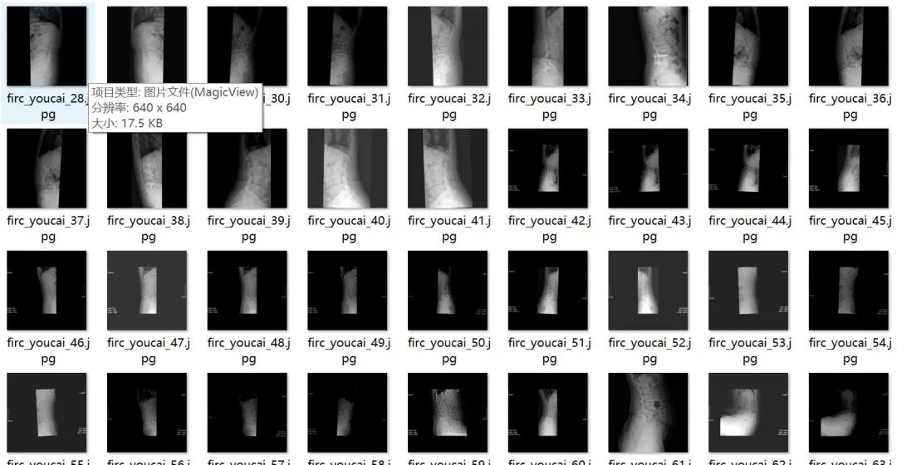
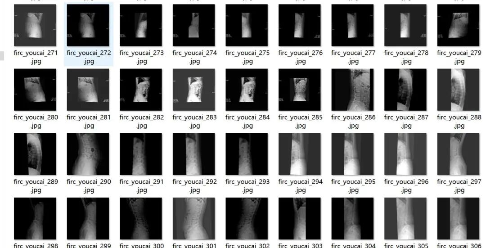
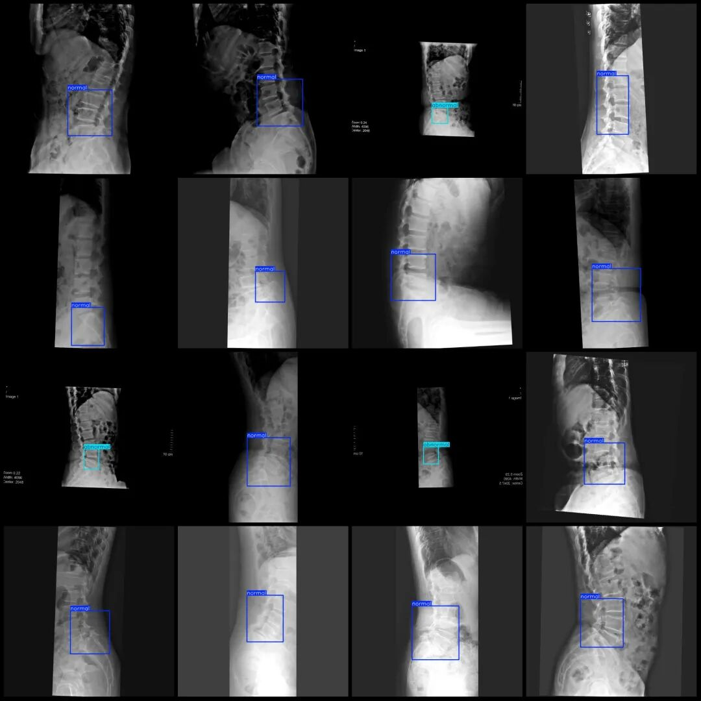
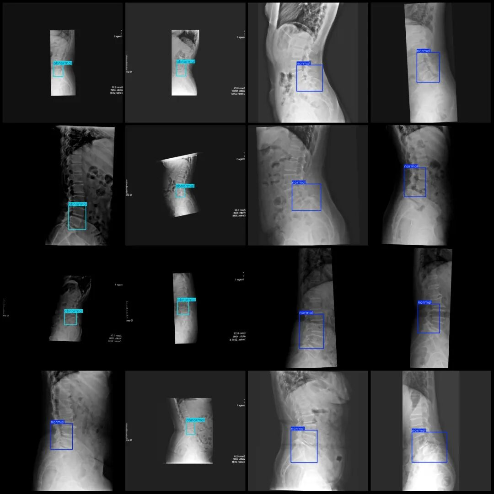

# VOC+YOLO format: 1261 images for spinal disc herniation detection in MRI images dataset with 2 categories

Please note that approximately 500 images in the dataset are original and the rest are enhanced.

Dataset format: Pascal VOC format + YOLO format (txt file without split path, only containing jpg images and corresponding VOC format xml files and yolo format txt files)

Number of images (number of jpg files): 1261

Number of annotations (number of xml files): 1261

Number of annotations (number of txt files): 1261

Labeling category count: 2

Label category names (Note that the order of categories in the YOLO format does not correspond to this, but is based on the classes.txt file in the labels folder): ["abnormal", "normal"]

Number of boxes labeled in each category:

Abnormal frame count = 439

Normal frame count = 822

Total frame count: 1261

Number of images per category:

Abnormal possession of images = 439

Normal occupancy count = 822

Image resolution: 640x640

Using labelImg:

Annotation rules: Draw a rectangle around the category.

Important Notice: The dataset does not have separate training, validation, and test sets; you need to partition them yourself.

Special : This dataset does not guarantee the accuracy of the trained models or weight files.

Image Preview:

Annotation example:

## Payment

Here is a pay link on Stripe ( https://buy.stripe.com/3cs8yP7sY87d0vu9AB ). Please contact me lonlonago@foxmail.com after funding $89, and I will send you a complete data files , thank you!

